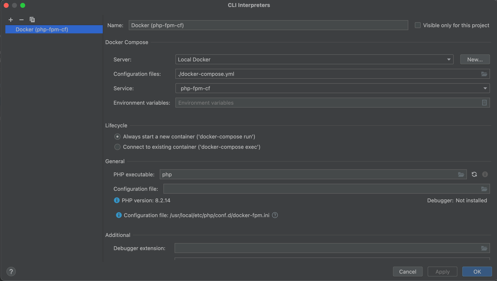
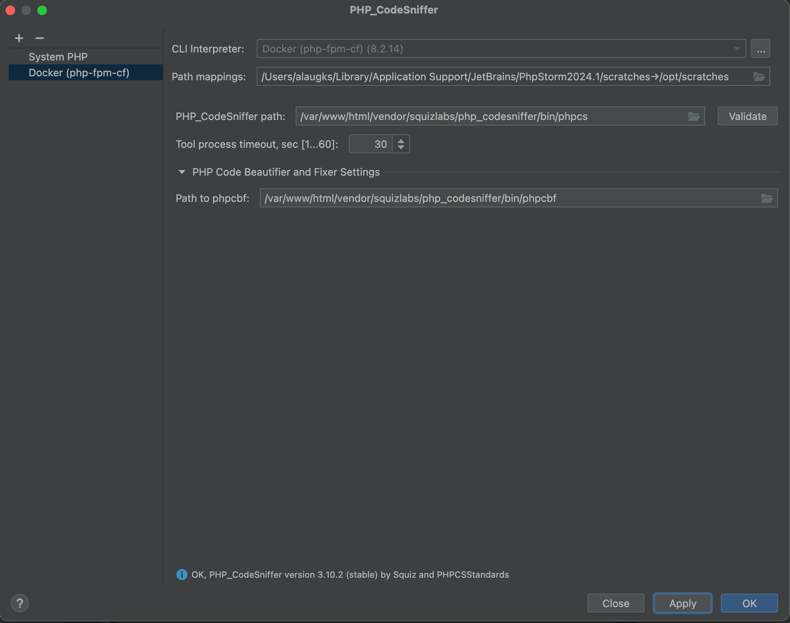
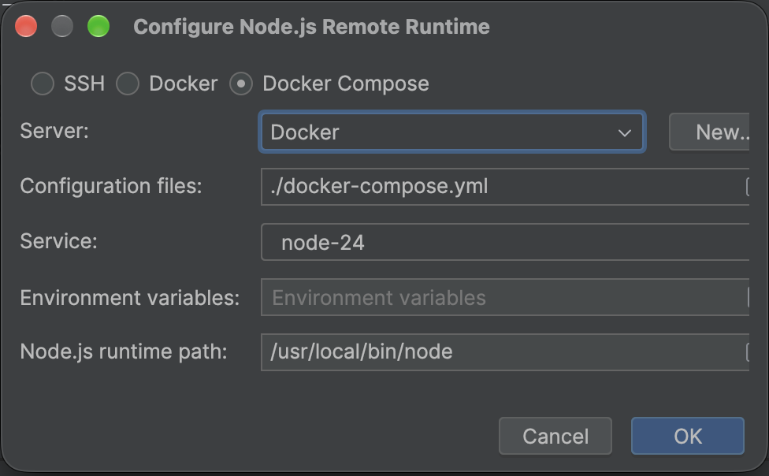

# Services for locale Development

## Table of contents

- [Services](#services)
- [Network](#network)
- [Installation](#installation)
  - [Clone project](#clone-project)
  - [Change directory](#change-directory)
  - [Run docker compose](#run-docker-compose)
- [Example of usage (MariaDB 10.9.*)](#example-of-usage-mariadb-109)
  - [Example Symfony](#example-symfony)
  - [Example Spring Boot](#example-spring-boot)
- [Use CodeSniffer in PHPStorm](#use-codesniffer-in-phpstorm)
- [Use Node.js and npm in JetBrains IDEs](#use-nodejs-and-npm-in-jetbrains-ides)

## Services
<table>
    <thead>
        <tr>
            <td>Service</td>
             <td>Container Name</td>
             <td>Ports</td>
             <td>Network</td>
             <td>Credentials</td>
        </tr>
    </thead>
    <tbody>
        <tr>
            <td>MariaDB 10.11.19</td>
            <td>mariadb-10-11</td>
            <td>13308:3306</td>
            <td>local_network</td>
            <td>
                RootUsername: root<br>
                RootPassword: root-password<br>
                DefaultDatabase: dev-database<br>
                DefaultUser: dev-user<br>
                DefaultPassword: dev-password<br>
            </td>
        </tr>
        <tr>
            <td>MariaDB 10.9.8</td>
            <td>mariadb-10-9</td>
            <td>13306:3306</td>
            <td>local_network</td>
            <td>
                RootUsername: root<br>
                RootPassword: root-password<br>
                DefaultDatabase: dev-database<br>
                DefaultUser: dev-user<br>
                DefaultPassword: dev-password<br>
            </td>
        </tr>
        <tr>
            <td>MariaDB 10.6.28</td>
            <td>mariadb-10-6</td>
            <td>13307:3306</td>
            <td>local_network</td>
            <td>
                RootUsername: root<br>
                RootPassword: root-password<br>
                DefaultDatabase: dev-database<br>
                DefaultUser: dev-user<br>
                DefaultPassword: dev-password<br>
            </td>
        </tr>
        <tr>
            <td>Redis 7.2.16</td>
            <td>redis-7-2</td>
            <td>16379:6379</td>
            <td>local_network</td>
            <td></td>
        </tr>
        <tr>
            <td>ValKey 8.1.10</td>
            <td>valkey-8-1</td>
            <td>26379:6379</td>
            <td>local_network</td>
            <td></td>
        </tr>
        <tr>
            <td>MongoDB 7.0.45</td>
            <td>mongo-7-0</td>
            <td>27017:27017</td>
            <td>local_network</td>
            <td>
                RootUsername: root<br>
                RootPassword: root-dev-password<br>
            </td>
        </tr>
        <tr>
            <td>PHP-FPM 8.4.27 for CodeSniffer</td>
            <td>php-fpm-cf</td>
            <td>10000:9000</td>
            <td>local_network</td>
            <td></td>
        </tr>
        <tr>
            <td>S3Mock 5.1.0</td>
            <td>s3mock</td>
            <td>9092:9090</td>
            <td>local_network</td>
            <td></td>
        </tr>
        <tr>
            <td>min.io RELEASE.2025-10-15T17-29-55Z</td>
            <td>minio</td>
            <td>
                9004:9000<br>
                9005:9001 (MinIO Console)
            </td>
            <td>local_network</td>
            <td>
                RootUsername: minio<br>
                RootPassword: dev-password<br>
            </td>
        </tr>
        <tr>
            <td>Node.js 24.22.0 LTS (npm)</td>
            <td>node-24</td>
            <td></td>
            <td>local_network</td>
            <td></td>
        </tr>
    </tbody>
</table>

## Network

All services are attached to the Docker network `local_network` (bridge driver, fixed name).
Containers in this network reach each other by their container name, e.g. `minio:9000`
(the host ports from the table above are only needed from the host machine).

To use the services from another Docker Compose project, attach that project to the same network:

```yaml
services:
  app:
    networks:
      - local_network

networks:
  local_network:
    external: true
```

## Installation

### Clone project

```bash
git clone git@github.com:alaugks/docker-local-env.git
```

### Change directory

```bash
cd docker-local-env
```

### Run docker compose

```bash
docker compose up -d
```


## Example of usage (MariaDB 10.9.*)

### Example Symfony

**.env.local**

```dotenv
DB_DRIVER=mysql
DB_USER=dev-user
DB_PASSWORD=dev-password
DB_HOST=mariadb-10-9
DB_PORT=3306
DB_NAME=your_database
DB_SERVER_VERSION=10.9.8-MariaDB
```

**services.yaml**

```yaml
parameters:
  database_url: '%env(DB_DRIVER)%://%env(DB_USER)%:%env(DB_PASSWORD)%@%env(DB_HOST)%:%env(DB_PORT)%/%env(DB_NAME)%?serverVersion=%env(DB_SERVER_VERSION)%'
```

### Example Spring Boot

**application.properties**

```dotenv
spring.datasource.url=jdbc:mariadb://mariadb-10-9:3306/your_database
spring.datasource.username=dev-user
spring.datasource.password=dev-password
spring.datasource.driver-class-name=org.mariadb.jdbc.Driver
```

## Use CodeSniffer in PHPStorm

**Settings CLI Interpreters**




**Settings PHP CodeSniffer**




**Path Code Sniffer**

```
/var/www/html/vendor/squizlabs/php_codesniffer/bin/phpcs
```


**Path Code Beautifier**

```
/var/www/html/vendor/squizlabs/php_codesniffer/bin/phpcbf
```

## Use Node.js and npm in JetBrains IDEs

The `node-24` container runs Node.js (current LTS) and npm, so no local Node.js installation is needed.
The container is a plain Node.js instance without a project mount.

1. Start the container: `docker compose up -d node-24`
2. In the IDE open **Settings > Languages & Frameworks > Node.js**
3. **Node interpreter** > **Add...** > **Add Remote...** > **Docker Compose**
4. Select `docker-compose.yml` of this project and the service `node-24`
5. Set the paths inside the container if the IDE asks for them (verified in the image):

**Settings Node.js Remote Runtime**



**Path Node.js**

```
/usr/local/bin/node
``` 

**Path npm**

```
/usr/local/bin/npm
```

**Path npm package (package manager in the IDE)**

```
/usr/local/lib/node_modules/npm
```

Alternatively, add the image `node:24.22.0-alpine` directly as a **Docker** interpreter (**Add Remote...** > **Docker**); the IDE then mounts the project itself.
